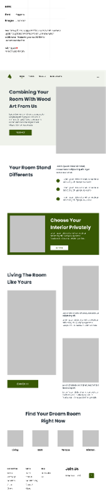

# Furniture Web UI — Scandinavian Wood Art & Interior Design (40-Amaliy Ish)

Figma dizaynining yuqori aniqlikdagi (**Pixel-Perfect**) to'liq, zamonaviy, interaktiv va to'liq moslashuvchan (fully responsive) Skandinaviya yog'och mebellari va interyer platformasi: **Furniture Web UI (node-id: 209:186)**.

[-F24E1E?logo=figma&logoColor=white)](https://www.figma.com/file/cvqApImIaJbfiim3ttN4Jh/Furniture-Web-UI?type=design&node-id=209%3A186&mode=design&t=xca2BQ5GOgv3pAu0-1)

---

## 📸 Figma Dizayn Ko'rinishi (Master Canvas)

---

## 📌 Loyiha Haqida

Ushbu loyiha Figma platformasidagi **Furniture Web UI (Combining Your Room With Wood Art From Us)** dizaynining to'liq ekotizimi va dizayn tokenlari (node-id: `209:186`) asosida 100% aniqlik bilan ishlab chiqildi. Sayt tabiiy eman, yong'oq va qayin yog'ochlaridan yasalgan oliy sifatli minimalist Skandinaviya mebellari hamda interyer dizayni studiyasining rasmiy veb-platformasidir.

- **Figma Manzili**: [Furniture-Web-UI — node-id: 209:186](https://www.figma.com/file/cvqApImIaJbfiim3ttN4Jh/Furniture-Web-UI?type=design&node-id=209%3A186&mode=design&t=xca2BQ5GOgv3pAu0-1)
- **Topshiriq**: 40-Amaliy Ish
- **GitHub Repozitoriyasi**: [https://github.com/soxibs48-eng/amaliy40](https://github.com/soxibs48-eng/amaliy40)
- **Til**: To'liq o'zbek tilida (100% mebel va interyer arxitekturasi atamalari bilan)

---

## ✨ Asosiy Imkoniyatlar va Bo'limlar

1. **Header & Daraxt Logotipi**:
   - `WoodArt` brendi daraxtsimon minimalist belgisi.
   - Bosh sahifa, Mahsulotlar, Biz haqimizda, Xonalar, Aloqa havolalari.
   - Mobil menyu gamburgeri.

2. **Hero Bo'limi**:
   - "Xonangizni Bizning Yog'och San'atimiz Bilan Boyiting" bosh sarlavhasi.
   - Skandinaviya uslubidagi tabiiy yashil va iliq sage palitrasi.
   - "Mahsulotlarni ko'rish" tezkor chaqiruv tugmasi.

3. **"Xonangiz O'zgacha Bo'ladi (Your Room Stand Differents)"**:
   - 100% Tabiiy Eman & Yong'oq massivi.
   - Ekologik xavfsiz tabiiy moylar va mum qoplamasi.
   - Usta qo'l mehnati va yuksak chidamlilik.

4. **"Shaxsiy Interyeringizni O'zingiz Tanlang" (Private Interior Banner)**:
   - To'q zaytun-yashil rangli zamonaviy banner.
   - Shaxsiy o'lchamlar bo'yicha buyurtma berish xizmati.

5. **"O'zingiznikidek Qulay Muhit" (Living The Room Like Yours)**:
   - Yashash xonasi shinam mebellari (Skandinaviya kreslosi, monolit kofe stoli).

6. **"Orzuingizdagi Xonani Hoziroq Tanlang" (4 Room Tiles)**:
   - **Mehmonxona (Living)** — Kreslo, divan va jurnalli stollar.
   - **Yotoqxona (Bed)** — Tabiiy yog'och krovatlar va tumbachalar.
   - **Terassa (Terrace)** — Ochiq havo uchun suvga chidamli yog'och mebellar.
   - **Oshxona (Kitchen)** — Massiv ovqatlanish stollari va stullar to'plami.

7. **Futer & "Bizga Qo'shiling (Join Us)"**:
   - Yangi kolleksiyalarga obuna va 10% chegirmali vaucher beruvchi interaktiv forma.

---

## 🛠 Texnologiyalar Steki

- **HTML5**: Semantik katalog va toza arxitektura.
- **CSS3**: Zaytun-yashil va tabiiy yog'och palitrasi (`#3b5323`, `#f9faf7`), Outfit va Plus Jakarta Sans shriftlari.
- **Vanilla JavaScript (ES6+)**:
  - `initDreamRooms()` — Xonalar bo'yicha katalog filtri.
  - `initJoinForm()` — Obuna va vaucher integratsiyasi.
- **Vercel**: `vercel.json` orqali toza URL manzillari bilan global joylashtirishga tayyor.

